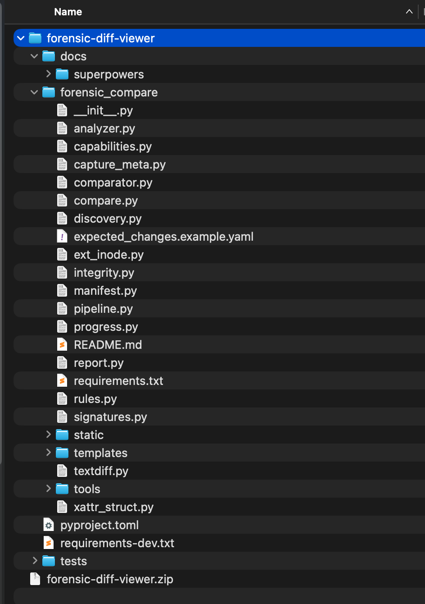
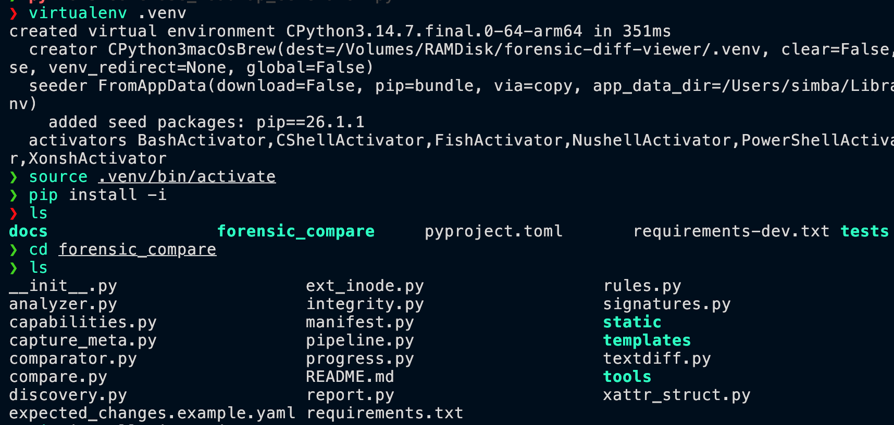
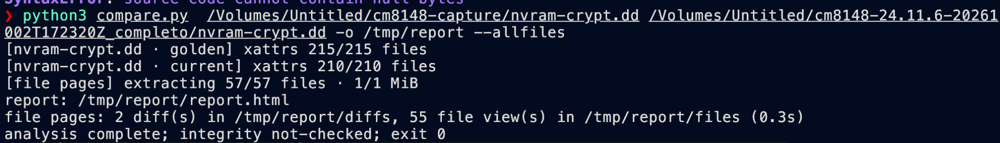
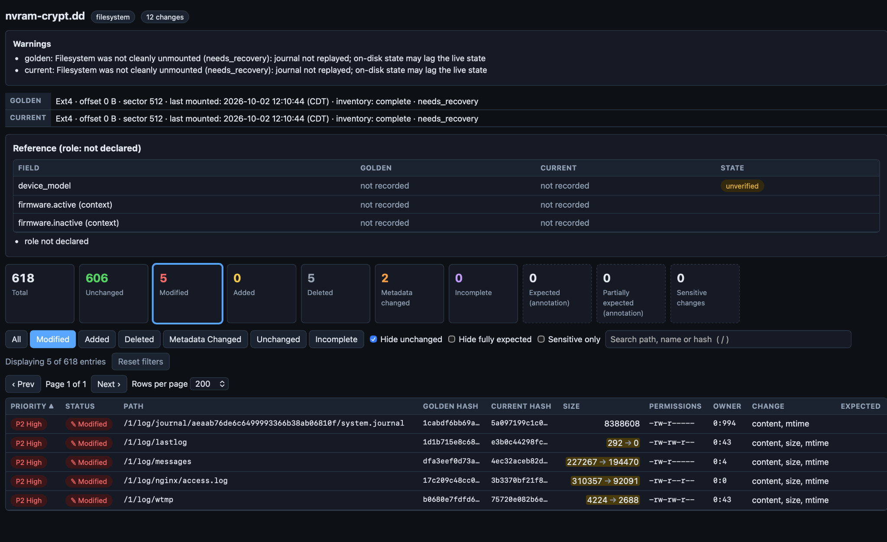

# forensic_compare

forensic_compare is a read-only tool that shows what changed on a Linux device between two
forensic captures. It takes a **golden** (baseline) capture and a **current** capture of the
same device, either as two capture directories or as a single pair of image files, and
compares them structurally with The Sleuth Kit and `debugfs`: partition layouts, ext2/3/4
filesystems, and, for every file, its content hash, size, permissions, ownership, mtime,
symlink target, extended attributes and Linux capabilities. Images are never mounted or
written to. A byte-by-byte diff of whole images is only used as a last resort, for sources the
tool cannot analyse structurally, and the report labels it as such.

The result is a self-contained HTML report that opens straight from disk, with no server and
no network access, plus a machine-readable `comparison.json` and a log of every external
command the tool ran. Each file gets a status (modified, added, deleted, metadata changed,
unchanged or incomplete) and a review priority that puts sensitive changes first, such as
SUID/SGID bits, capabilities, new symlinks and changed binaries or scripts. Analysts can
supply expected-change rules to mark known differences, such as logs or configuration, and
modified text files get side-by-side line diffs. The tool reports differences as facts, not
verdicts: it never decides that a device is compromised, and anything it could not read or
verify is shown as *not assessed*, never as unchanged.

Principles:

- **Differences are facts, not verdicts.** Configuration, logs and device-specific keys are
  expected to differ, so nothing is classified as compromise automatically. "Expected" is an
  analyst annotation; it does not mean a file is safe.
- **Incomplete is never unchanged.** Anything that could not be read or validated is shown as
  *not assessed*, and the analysis is marked incomplete.
- **Inputs are read-only.** Images are opened `O_RDONLY` and never mounted. `debugfs` runs
  without `-w`, in catastrophic mode (`-c`), which forces a read-only open.
- **Provenance is explicit.** Every metadata value records where it came from. Unknown values
  stay unknown.
- **Image integrity is the analyst's step.** By default the images are not hashed: verify them
  before the run. `--verify-integrity` hashes every image before and after the analysis and
  checks the supplied checksum manifests. Without it, integrity shows as *not checked*.
- **Integrity ≠ authenticity.** "Verified" means the image matches a supplied checksum and did
  not change during analysis. It does not establish that the firmware is authentic or free of
  compromise.

## Quick start (macOS or Linux)

Setup and a first run, step by step. The same guide is also available as
[`forensic_diff_viewer_guide.html`](forensic_diff_viewer_guide.html).

### Project structure



### 1. Extract the Project

Extract the `forensic-diff-viewer.zip` archive and open a terminal in the extracted project directory.

### 2. Create a Python Virtual Environment

```bash
virtualenv .venv
source .venv/bin/activate
```

### 3. Enter the Application Directory

```bash
cd forensic_compare
```

### 4. Install Python Dependencies

```bash
pip install -r requirements.txt
```



### 5. Install Required Forensic Tools

The Sleuth Kit 4.12 or later is required (`mmls`, `fsstat`, `fls`, `icat`) plus `debugfs` from e2fsprogs.

On macOS with Homebrew:

```bash
brew install sleuthkit e2fsprogs
```

On Apple Silicon Macs, add `e2fsprogs` to your `PATH`:

```bash
echo 'export PATH="$PATH:/opt/homebrew/opt/e2fsprogs/sbin:/opt/homebrew/opt/e2fsprogs/bin"' >> ~/.zshrc
source ~/.zshrc
```

On Debian or Ubuntu with `apt`:

```bash
sudo apt update
sudo apt install sleuthkit e2fsprogs
```

### 6. Verify Required Commands

Run these checks on macOS or Linux:

```bash
which fls
which debugfs
which fsstat
which icat
```

Each command should return a valid executable path.

### 7. Run a Comparison

General syntax:

```bash
python3 compare.py File1 File2 -o /destination_report --allfiles
```

Example:

```bash
python3 compare.py /Volumes/Untitled/cm8148-capture/nvram-crypt.dd /Volumes/Untitled/cm8148-24.11.6-20261002T172320Z_completo/nvram-crypt.dd -o /tmp/report --allfiles
```



### 8. Open the Generated Report

On macOS:

```bash
open /tmp/report/report.html
```

You can also open the output folder manually and open `report.html` in a browser.



## Usage

```bash
# two capture directories: images are paired by exact filename
python forensic_compare/compare.py golden/ current/ -o report/

# a single pair of images (the names may differ)
python forensic_compare/compare.py clean.dd current.dd -o report/

# options
  --rules FILE      expected-change rules (see forensic_compare/expected_changes.example.yaml)
  --jobs N          concurrent tool processes (default min(4, CPUs))
  --timeout SEC     per-command timeout (default 600)
  --force           write into a non-empty output dir (removes only the previous run's files)
  --verify-integrity  hash every image before and after the analysis and check checksum files
  --no-text-diffs   do not write the line diff and file pages (see below)
  --allfiles        also write a content page for unchanged and incomplete text files
  --quiet           no progress output
```

### Exit codes

| Code | Meaning |
|---|---|
| 0 | Report generated and analysis complete (with `--verify-integrity`: and every image `verified`) |
| 3 | Report generated, but the analysis is incomplete or limited, or (with `--verify-integrity`) some integrity is not `verified` |
| 2 | Usage error or fatal error |

Differences, however many, never change the exit code.

### Output

```
report/
├── report.html               # open directly from disk; no server, no network
├── comparison.json           # everything the report shows
├── manifests/<source>/{golden,current}.json
├── supporting/{golden,current}/   # device-info.txt, checksum files (verbatim)
├── diffs/NNNN.html            # one line-diff page per modified text file
├── files/NNNN.html            # one content page per added, deleted or metadata-changed text
│                              #   file (with --allfiles: per other text file too)
├── tool_log.jsonl            # every external command: argv, status, diagnostics, timing, bytes
└── outputs.json              # the files written by this run (used by --force)
```

The output directory must not overlap the capture directories, in either direction and
including through symlinks. The tool refuses to write into a non-empty directory unless
`--force` is given. Even then it removes only the files listed in the previous run's
`outputs.json`.

## Capture directory

```
golden/
├── config-active-crypt.dd      # images: .dd .img .raw .bin
├── config-other-crypt.dd
├── nvram-crypt.dd
├── mmcblk0.dd
├── mtdblock0.bin
├── SHA256SUMS                  # used with --verify-integrity; *.sha256 / *.sha256sum also accepted
└── device-info.txt             # optional; copied verbatim and shown in the report, never parsed
```

The following files are listed as "not used":

- `*.partial`;
- `*.received.sha256`, which is a stream checksum, not an image manifest;
- logs and anything else.

In checksum manifests, only entries that name an image in the same directory are used. An
entry named `-` (stdin, as written by `dd … | sha256sum`) names no file, so it is used only in
a per-image checksum file whose sole entry it is, for the one image the file is named after:

| Checksum file | Image |
|---|---|
| `mmcblk0.dd.sha256` | `mmcblk0.dd` |
| `mtdblock0.sha256` | `mtdblock0.bin` (the only image named `mtdblock0.*`) |
| `config-active-crypt.raw.sha256` | `config-active-crypt.dd` (the only image named `config-active-crypt.*`) |

When the name matches no image or several, or the file has other entries, the `-` entry is
ignored and the report says why. A wrong association can only give a mismatch (FAILED), never
a false *verified*. `SHA256SUMS` entries must always name the image.

How each image is handled:

| Detected | Handling |
|---|---|
| ext2/3/4 filesystem image | Full file and metadata comparison |
| Partitioned disk (MBR/GPT) | Layout comparison. ext partitions are fully compared as their own sections. LUKS partitions are reported as *encrypted*; squashfs, UBI and JFFS2 as *unsupported (needs extractor)*; anything else as *unknown*. The absence of a signature never means "unencrypted". |
| Anything else (e.g. raw flash `.bin`) | *Image-level only*: signature detection and an identical/different image hash. This is not a file-level comparison. |
| Present on one side only | *Unmatched source*. Its integrity is checked with `--verify-integrity`. Its contents are never reported as added or deleted. |

When two image files are compared, the checksum files and `device-info.txt` of each image's
own folder are used.

## What is compared per file

| Field | Notes |
|---|---|
| path | Matched by raw bytes. TSK renders control characters as `^`, so paths containing `^` are flagged *name may have been altered*. |
| SHA-256 | Logical content via `icat`: sparse holes are hashed as zeros, slack is excluded, and the byte count is verified against the size. |
| size | Files and symlinks only; directory sizes are not compared. |
| permissions | Permission bits plus sticky, with SUID and SGID reported as separate fields. |
| uid / gid | — |
| mtime | Seconds precision (from `fls -m`). atime, ctime and crtime are shown as context only. |
| symlink target | **Fast symlinks:** read from the raw inode, because TSK 4.12.1 `icat` returns NULs for them; cross-checked against the `fls` listing. **Slow symlinks:** read with `icat`. Links are never followed. |
| xattrs | Enumerated with `debugfs ea_list`, fetched with `ea_get -f` by inode, and cross-validated against an independent parse of the on-disk xattr structures. debugfs 1.47.2 can silently return an empty list for a corrupt EA block, so a disagreement means *not assessed*. |
| capabilities | `security.capability` decoded (v1/v2/v3, including rootid); the raw hex is kept. |

The root directory `/` is included, taken from raw inode 2, because `fls` does not list it.

### Statuses

Every entry gets exactly one status:

| Status | Meaning |
|---|---|
| **Modified** (red) | The type, content or symlink target changed. |
| **Added** (yellow) | Present only in current. Requires a complete inventory on the other side. |
| **Deleted** (gray) | Present only in golden. Requires a complete inventory on the other side. |
| **Metadata changed** (orange) | Only metadata changed. |
| **Unchanged** (green) | Every field was assessed and is equal. |
| **Incomplete** (purple) | No difference among the assessed fields, but something was not assessed. |

A Modified, Metadata changed, Added or Deleted entry with a not-assessed field also carries an
*incomplete* badge.

### Review priority

Priority is computed on the differences that rules do not cover. It is a review order, not a
compromise verdict.

| Priority | Conditions |
|---|---|
| P1 | Any sensitive change: SUID/SGID, capabilities, `security.*` xattrs, ownership changed to root, a new symlink, a type change to symlink. Also any content, existence or type change on an ELF binary or script, on any file in a boot partition (fsstat: last mounted at `/boot`), or on a path matched by `elevate`. |
| P2 | Other content, existence or type changes, and incomplete entries. |
| P3 | Metadata-only changes. |
| P4 | Fully expected entries. |
| P5 | Unchanged entries. |

No signature validity is checked.

## Expected-change rules

See `forensic_compare/expected_changes.example.yaml`. The example is illustrative only and
contains no enabled rules.

Rule semantics:

- **Matching.** A rule matches by exact source id (an image name, or `mmcblk0.dd#p1` for a
  partition), by path glob and by status.
- **Coverage.** A rule covers only the listed fields:
  - added and deleted entries need `existence`;
  - `suid`, `sgid`, `capability` and `xattr:security.*` must be named explicitly.
- **Expectation levels.**
  - **Fully expected:** every difference is covered and the entry was fully assessed.
  - **Partially expected:** some differences are covered; the uncovered ones keep their
    priority.
- **Globs.**
  - Paths are relative to the filesystem root and matching is case-sensitive.
  - `*` matches within one directory level, `**` crosses directories, and `?` matches one
    character.
- **Reporting.** The report lists every rule with its match count, shows "No matches" for
  rules that matched nothing, and records the rules file's SHA-256.
- **Filtering.** *Hide fully expected* is off by default. It never hides partially expected
  or incomplete entries, and it never hides notices.

## The report

A walkthrough of every view, with what each field, status and chip means, is in
[docs/report-guide.md](docs/report-guide.md).

- **Banners:** persistent banners for Integrity FAILED and Incomplete analysis (something
  could not be read or compared). They can be collapsed but never dismissed. Format limits
  (encrypted or unsupported partitions, image-level sources) are the same on every run of a
  device, so they are not banners: the overview lists them, and their sections show them.
- **Start view:** the report opens on the file table of the first filesystem section.
- **Overview:** headline tiles (changed entries, sensitive changes, image integrity, analysis
  state), changed entries per filesystem on one scale with status counts that open the file
  table already filtered, the partitions of each disk (compared or not analysed, and why),
  the raw images with their identical/different hash, and the format limits.
- **Sidebar:** per-source sections, plus disk partitions, image-level and unmatched sources,
  integrity, device info, rules, files not used, and tools.
- **Device info:** each side's `device-info.txt` as captured, side by side, with the lines that
  differ highlighted and an *Only differing lines* filter. Section labels (date, `uname -a`,
  `/proc/partitions`, `lsblk`, `blkid`) are recognised from the command output format, only to
  make the text easier to read; no value in the file is used by any check. Up to 1 MiB per side
  is shown; the full file is in `supporting/`.
- **Summary cards:** computed before filters are applied.
- **Filters:** status filters (All, Modified, Added, Deleted, Metadata Changed, Unchanged,
  Incomplete), *Hide unchanged* (on by default), *Hide fully expected*, *Sensitive only*,
  search by path, name or hash (`/` to focus), "Displaying X of Y entries", and Reset filters.
- **Table:** sortable columns and pagination; only the visible page is in the DOM.
- **Detail panel:** golden vs current with every field and its assessment state, the
  differences highlighted, and rule coverage per difference. It opens below the table, as a
  full-width drawer docked at the bottom of the window (room for full SHA-256 hashes), or
  beside it; *⇥ Beside* / *⇩ Below* switches, and the browser remembers the choice.
- **Theme:** light and dark.
- **Logo:** `logo.png` at the repository root is embedded in the top-left of the top bar
  (shown 44 px high, up to 320 px wide; a wide banner such as 1200×240 fits best). Replace it
  with your own; PNG, JPEG, GIF, WebP or SVG content works under that name. Delete it for no
  logo. An unreadable file prints a warning and the report is built without it.
- **Security:** a CSP with exact hashes of the inline script and style, no network access, and
  data rendered as text only. The CSP allows `data:` images only when a logo is embedded. This
  is defense in depth, not a guarantee.

Phase 2, decided but not yet implemented:

- column chooser;
- font controls and monospace option;
- zoom, Fit to Page and Full Screen;
- card view on narrow screens;
- virtualized rendering;

## Line diffs and file pages

Every **Modified** regular file whose content changed and is text on both
sides gets a side-by-side line diff page, `diffs/NNNN.html`. Every **Added**, **Deleted** and
**Metadata changed** regular text file gets a content page, `files/NNNN.html` (golden for
deleted files, current otherwise). The *Open* column of the file table and the detail panel
link to them ("diff ↗", "view ↗").

- **Re-read and checked.** Each version is extracted again with `icat` (read-only), and the
  page is written only if it matches the SHA-256 recorded during the analysis.
- **`--allfiles`.** Unchanged and incomplete text files also get a content page (current).
  This re-reads every text file, so on large images it adds time and output size. The run
  prints how many pages were written and how long it took.
- **Limits.** Files above 1 MiB, binary files (ELF, other binary) and anything over 64 MiB in
  total get a reason instead of a page. Diffs come first in the 64 MiB budget.
- **Display.** Long unchanged runs are collapsed. Similar lines get character-level
  highlights. Invalid UTF-8 is shown as `�`.
- **Safety.** The pages have no script and a strict CSP, and content is rendered as escaped
  text.
- **Content in the output.** The pages contain the file content, so handle the output
  directory as evidence. `--no-text-diffs` turns them off. Diffs never change a status, a
  priority or the exit code.

## Limitations

- **Squashfs** (the firmware root filesystems) is not analysed yet; it needs a read-only
  extractor. Firmware binary changes are therefore **not** covered by the MVP.
- **Timestamps:** mtime is compared at one-second precision.
- **Lossy names:** names containing control characters are rendered lossily by TSK and flagged
  as such.
- **Live captures:** the filesystem may need journal recovery. `needs_recovery` is reported,
  and the journal is not replayed. Allocation-bitmap checksums may not match; they are not
  read (`debugfs -c`) and are not reported.
- **Performance:** one `icat` process runs per regular file. 20,000 files per side took about
  4.5 minutes with `--jobs 4` on the test machine.

## Development and tests

```bash
python3 -m venv .venv && .venv/bin/pip install -r requirements-dev.txt
.venv/bin/playwright install chromium

.venv/bin/python -m pytest                       # integration/browser tests skip if tools are missing
.venv/bin/python -m pytest --strict-validation   # skips of required tests count as failures
.venv/bin/python -m pytest -m "not slow"         # without the ~5 min large-inventory test
```

`FC_TSK_BIN_DIR` and `FC_TSK_LIB_DIR` can point the tests at a non-system sleuthkit build.

Fixtures are synthetic ext4 images built by `tests/fixtures/build.py` with `mke2fs -d`.
`debugfs -w` is used **only** on those freshly generated images. Determinism is verified by
building twice and comparing hashes, and the tool versions and filesystem features are recorded
in `fixtures-metadata.json`.

## Real-image validation (separate acceptance step)

Synthetic fixtures establish how the implementation behaves. They do not establish
compatibility with the real device images. Before relying on the tool, run it on the real
captures and confirm:

- [ ] Whether `/etc/version` exists in any standalone image or in `/boot`. The tool does not
      assume it does.
- [ ] The real log, data and key paths, to write `--rules` (none are assumed).
- [ ] The encryption format observed on mmcblk0 p3/p5/p6.
- [ ] The real `fls`, `fsstat` and `debugfs` diagnostics. Extend
      `forensic_compare/tools/diagnostics.py` only with understood messages.
- [ ] No unexpected *not assessed* xattr results on real kernel-written inodes. The
      structural check treats a non-empty in-inode EA area without the EA magic as an error.
- [ ] Runtime and report size on the real NVRAM image.
- [ ] The `.bin` sources (`mtdblock0.bin`, `mmcblk0boot0/1.bin`) are detected and labelled as
      expected.
