<p align="center">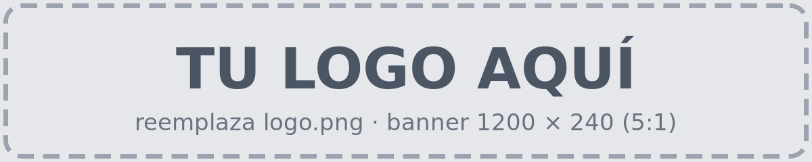</p>

# Report walkthrough

A step-by-step tour of a real `forensic_compare` report, followed by a short investigation.
The screenshots come from a comparison of two CM8148 captures, run with:

```bash
python3 compare.py /Users/harji/evidence/golden /Users/harji/evidence/evidence \
  -o /tmp/case1/ --verify-integrity --allfiles
```

The first folder is the **golden** capture (the clean reference) and the second is the
**current** capture (the device under investigation). For a full reference of every view,
field and status, see [report-guide.md](report-guide.md).

## Contents

**Tour of the report**

1. [The start page](#1-the-start-page)
2. [Overview](#2-overview)
3. [Search](#3-search)
4. [View a file](#4-view-a-file)
5. [Line diff](#5-line-diff)
6. [The whole file](#6-the-whole-file)
7. [Image hashes](#7-image-hashes)
8. [Device info](#8-device-info)
9. [Tools & run](#9-tools--run)

**How to investigate**

10. [Open a file's details](#10-open-a-files-details)
11. [Details beside or below the table](#11-details-beside-or-below-the-table)
12. [Filter the modified files](#12-filter-the-modified-files)
13. [Check what changed and open the line diff](#13-check-what-changed-and-open-the-line-diff)
14. [Read the changes](#14-read-the-changes)

---

## Tour of the report

### 1. The start page

The report opens on the file table of the first filesystem, here `config-active-crypt.dd`.
At the top are the summary cards (291 entries: 126 unchanged, 10 modified, 81 added, 50
deleted, 24 metadata changed) and the filters. The sidebar gives access to the **Overview**,
every **source** image with its number of changes, and the **case** views (Integrity, Device
info, Expected-change rules, Files not used, Tools & run).

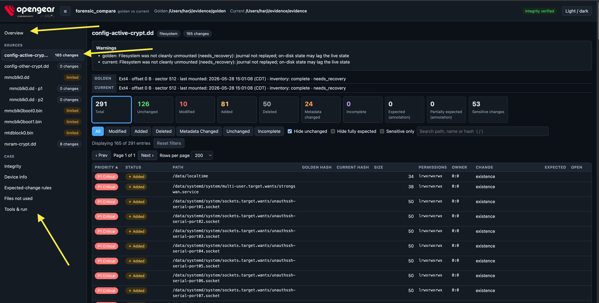

### 2. Overview

The summary of the whole comparison: changed entries, sensitive changes, image integrity and
analysis state; the changed entries of each filesystem, with links that open the file table
already filtered; the partitions of the disk; and the raw images, compared by hash.

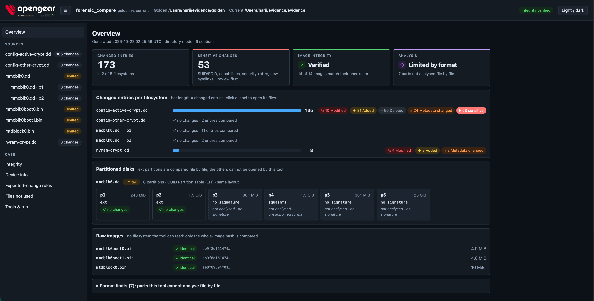

### 3. Search

Type in the search box (press `/` to jump to it) to filter by path, name or hash. Searching
for `pass` leaves two entries: `/data/pam.d/common-password` (added) and `/data/passwd`
(modified). The **Open** column links to the content of each one: **view ↗** for the added
file, **diff ↗** for the modified one.

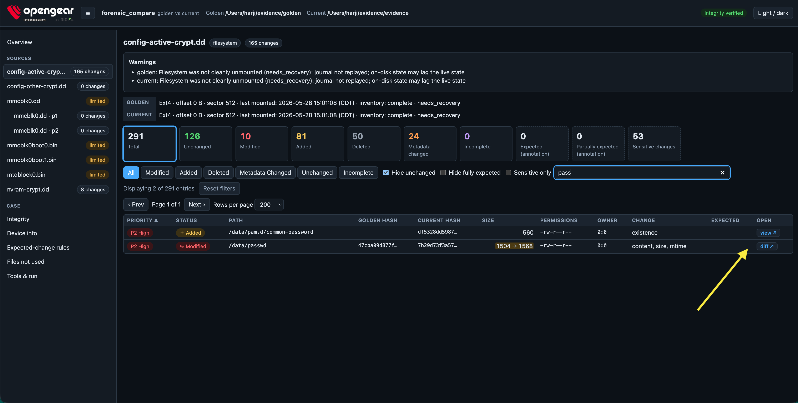

### 4. View a file

**view ↗** opens the content of the file in a new tab. Here, the added
`/data/pam.d/common-password`, with its SHA-256. The content is extracted again read-only and
shown only if it matches the hash recorded during the analysis.

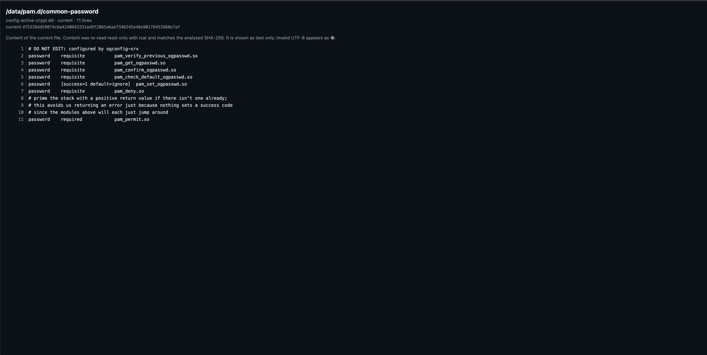

### 5. Line diff

**diff ↗** opens a side-by-side diff of a modified file: golden on the left, current on the
right. Added lines are highlighted in green and removed lines in red. In `/data/passwd`, the
current capture has one extra line, the user `havi`. Runs of unchanged lines are collapsed.

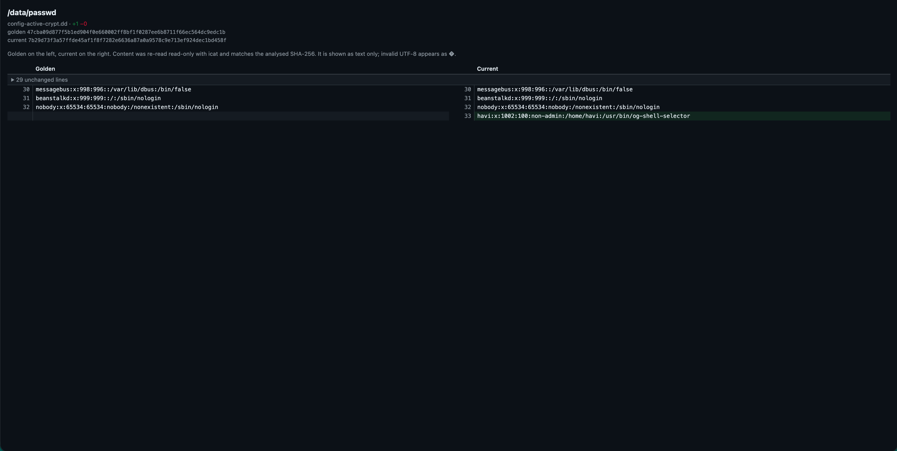

### 6. The whole file

Click a collapsed block, such as *29 unchanged lines*, to expand it and see the whole file.

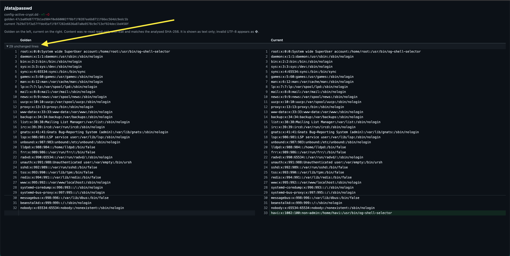

### 7. Image hashes

**Integrity** lists every image of both captures with its verdict, the checksum supplied at
capture time and the SHA-256 taken before and after the analysis. Here all 14 images are
**verified**: each one matches its checksum and did not change during the analysis. *Verified*
proves the image is the one that was captured; it does not prove the firmware is authentic.

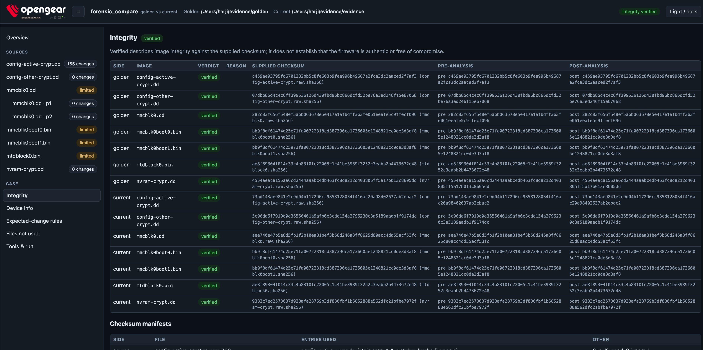

### 8. Device info

The information captured from each device (`device-info.txt`), side by side, with the lines
that differ highlighted. The capture date always differs.

The `/tmp/evidence` line always appears as well: it is the USB drive the data is extracted to,
and it must be mounted during the capture. Its mount point can change between captures (here
`/tmp/evidence` and `/tmp/evidence2`), so that line can differ too. It is not a finding.

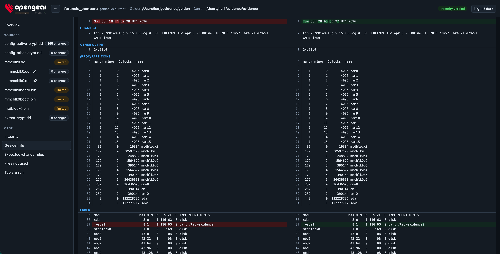

### 9. Tools & run

The technical reference of the run: when the report was generated, the exact command, the
mode, both inputs, the forensic_compare version and the version of every external tool used
(debugfs, fls, fsstat, icat, mmls). Every external command is also logged in `tool_log.jsonl`
next to the report.

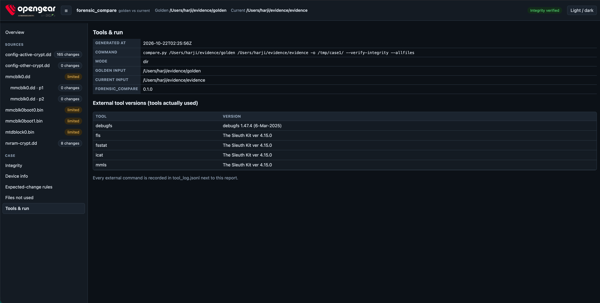

---

## How to investigate

### 10. Open a file's details

Click a file in the table to see its information: golden against current for every field
(type, mode, owner, size, mtime, SHA-256, symlink target, capabilities, extended
attributes), with the fields that differ highlighted. Here, an added symlink: it is *absent*
in golden and points to `/lib/systemd/system/unauthssh-serial-port02.socket` in current.

The details open below the table. To move them to the side, click **⇥ Beside**.

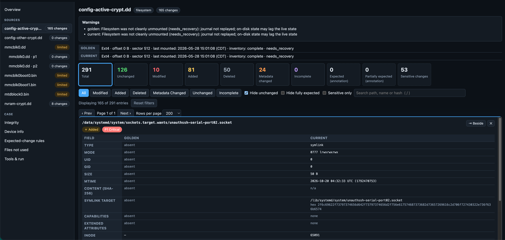

### 11. Details beside or below the table

With the details beside the table, click **⇩ Below** to bring them back underneath. The report
remembers the choice. Below the table, there is room for full SHA-256 hashes on one line.

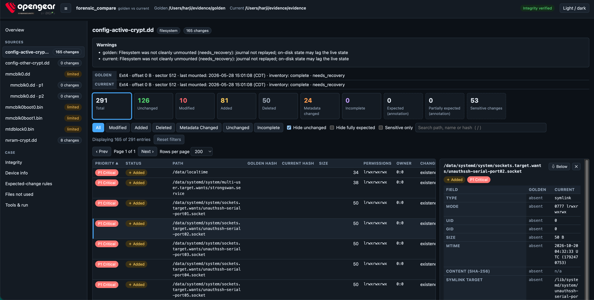

### 12. Filter the modified files

Use the filters to focus on one kind of change. **Modified** (the button or the card) leaves
the 10 files whose content changed. The **Size** column shows `golden → current`, for example
`/data/config/conman.conf`, from 27217 to 27996 bytes.

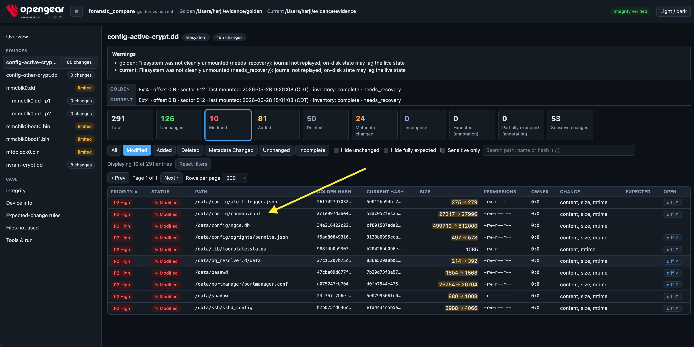

### 13. Check what changed and open the line diff

Click the file to see its details: the size, the mtime and the **SHA-256** are highlighted
because they changed. **Open line diff in a new tab ↗** opens the changes; the chips next to
it count the lines added (+19) and removed (−13).

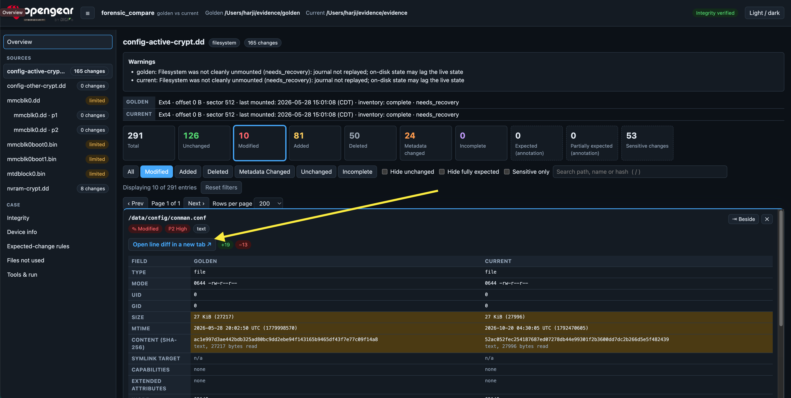

### 14. Read the changes

The diff opens in a new tab, with golden on the left and current on the right. Changed lines
are highlighted, and the exact characters that changed are marked inside them. In
`conman.conf`, for example, the ping test of each network probe changed from `8.8.8.8` to
`1.1.1.1` with a fallback to `8.8.4.4`.

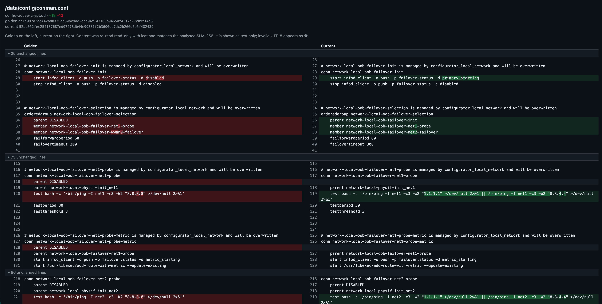

Further down, a static route block exists only in current. Collapsed blocks such as
*48 unchanged lines* expand with a click.

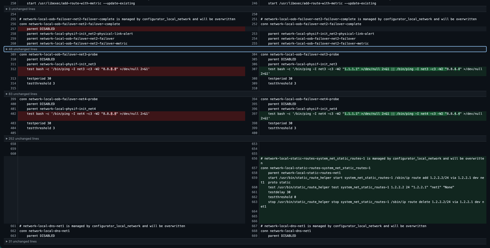

Differences are facts, not verdicts: the report shows what changed, and deciding whether a
change is legitimate is the analyst's job.
